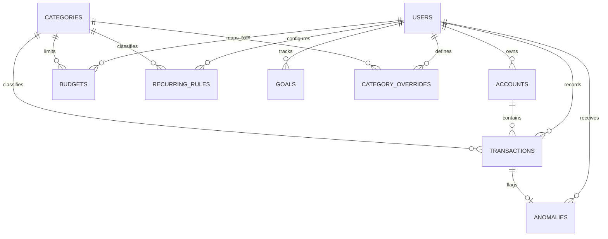

# FinPilot AI: Relational Database Design Specification

**Version:** 1.0.0  
**ORM:** SQLAlchemy 2.0 (Declarative Base)  
**Migrations:** Alembic  
**Dialect Portability:** SQLite (Local Dev / Automated CI) & PostgreSQL 15+ (Production)  

---

## 1. Entity-Relationship (ER) Overview

---

## 2. Table Schemas & Data Dictionaries

### 2.1 Table: `users`
Stores user identity, credentials, preferences, and demo account status.

| Column | Type | Constraints | Description |
| :--- | :--- | :--- | :--- |
| `id` | `INTEGER` | PK, Autoincrement | Unique user identifier |
| `email` | `VARCHAR(255)` | UNIQUE, NOT NULL, Index | User email address |
| `password_hash` | `VARCHAR(255)` | NOT NULL | Bcrypt hashed password |
| `full_name` | `VARCHAR(150)` | NOT NULL | Display name |
| `currency` | `VARCHAR(10)` | NOT NULL, DEFAULT `'INR'` | Currency code |
| `is_active` | `BOOLEAN` | NOT NULL, DEFAULT `TRUE` | Account status |
| `is_demo` | `BOOLEAN` | NOT NULL, DEFAULT `FALSE` | Flag for seeded demo persona |
| `created_at` | `DATETIME` | NOT NULL, DEFAULT `CURRENT_TIMESTAMP` | Account creation timestamp |
| `updated_at` | `DATETIME` | NOT NULL, DEFAULT `CURRENT_TIMESTAMP` | Last profile update |

---

### 2.2 Table: `accounts`
Stores bank accounts, credit cards, UPI wallets, and investment accounts.

| Column | Type | Constraints | Description |
| :--- | :--- | :--- | :--- |
| `id` | `INTEGER` | PK, Autoincrement | Unique account identifier |
| `user_id` | `INTEGER` | FK(`users.id`), NOT NULL, Index | Owner reference |
| `name` | `VARCHAR(100)` | NOT NULL | Account name (e.g. "HDFC Salary A/C") |
| `account_type` | `VARCHAR(30)` | NOT NULL | `SAVINGS`, `CURRENT`, `CREDIT_CARD`, `INVESTMENT`, `CASH` |
| `institution` | `VARCHAR(100)` | NOT NULL | Bank/Institution (e.g. "HDFC Bank", "SBI") |
| `account_number_mask` | `VARCHAR(20)` | NULL | Masked identifier (e.g. `*4821`) |
| `balance` | `NUMERIC(14, 2)`| NOT NULL, DEFAULT `0.00` | Current verified balance |
| `currency` | `VARCHAR(10)` | NOT NULL, DEFAULT `'INR'` | Account currency |
| `is_active` | `BOOLEAN` | NOT NULL, DEFAULT `TRUE` | Active/Archived status |
| `created_at` | `DATETIME` | NOT NULL, DEFAULT `CURRENT_TIMESTAMP` | Record creation timestamp |
| `updated_at` | `DATETIME` | NOT NULL, DEFAULT `CURRENT_TIMESTAMP` | Last balance update |

---

### 2.3 Table: `categories`
Standard Indian financial taxonomy and customizable user categories.

| Column | Type | Constraints | Description |
| :--- | :--- | :--- | :--- |
| `id` | `INTEGER` | PK, Autoincrement | Unique category identifier |
| `name` | `VARCHAR(80)` | NOT NULL | Display name (e.g. "Food & Dining") |
| `slug` | `VARCHAR(80)` | NOT NULL, Index | System slug (e.g. `food-dining`) |
| `icon` | `VARCHAR(50)` | NOT NULL, DEFAULT `'tag'` | Lucide icon identifier |
| `color` | `VARCHAR(20)` | NOT NULL, DEFAULT `'#64748b'`| Hex color code for UI |
| `is_income` | `BOOLEAN` | NOT NULL, DEFAULT `FALSE` | Income category flag |
| `is_system` | `BOOLEAN` | NOT NULL, DEFAULT `TRUE` | Global system vs user-created |
| `user_id` | `INTEGER` | FK(`users.id`), NULL, Index | NULL for system; set for custom |
| `created_at` | `DATETIME` | NOT NULL, DEFAULT `CURRENT_TIMESTAMP` | Category creation timestamp |

*Default System Categories:*
- **Income:** Salary, Freelance / Consulting, Dividends & Interest, Refunds & Cashback, Other Income.
- **Expenses:** Food & Dining, Groceries & Essentials, Housing & Rent, Utilities & Bills, Transportation & Fuel, Shopping & Lifestyle, Health & Medical, Entertainment & Subscriptions, Investments & SIP, Debt & EMI, Education, Miscellaneous.

---

### 2.4 Table: `transactions`
The core immutable financial ledger holding all debit/credit movements.

| Column | Type | Constraints | Description |
| :--- | :--- | :--- | :--- |
| `id` | `INTEGER` | PK, Autoincrement | Primary key |
| `user_id` | `INTEGER` | FK(`users.id`), NOT NULL, Index | Multi-tenant user owner |
| `account_id` | `INTEGER` | FK(`accounts.id`), NOT NULL, Index | Linked account |
| `category_id` | `INTEGER` | FK(`categories.id`), NOT NULL, Index | Assigned category |
| `date` | `DATE` | NOT NULL, Index | Transaction posting date |
| `amount` | `NUMERIC(14, 2)`| NOT NULL | Transaction amount (always positive) |
| `transaction_type` | `VARCHAR(10)` | NOT NULL | `DEBIT` or `CREDIT` |
| `narration` | `VARCHAR(500)`| NOT NULL | Cleaned merchant / narration text |
| `raw_narration` | `VARCHAR(1000)`| NULL | Original bank statement line / SMS |
| `merchant_name` | `VARCHAR(150)`| NULL | Extracted merchant / counterparty |
| `payment_mode` | `VARCHAR(30)` | NOT NULL, DEFAULT `'UPI'`| `UPI`, `NET_BANKING`, `DEBIT_CARD`, `CREDIT_CARD`, `CHEQUE`, `CASH` |
| `reference_id` | `VARCHAR(100)`| NULL, Index | Bank UTR / UPI reference / Cheque No |
| `is_recurring` | `BOOLEAN` | NOT NULL, DEFAULT `FALSE` | Flagged as recurring subscription/bill |
| `fingerprint` | `VARCHAR(64)` | NOT NULL, Index | SHA-256 `(user_id, date, amount, type, normalized_text)` for dedup |
| `categorization_method`| `VARCHAR(20)` | NOT NULL, DEFAULT `'MANUAL'`| `RULE`, `ML`, `MANUAL`, `DEFAULT` |
| `categorization_confidence`| `NUMERIC(4, 3)`| NULL | Confidence score (0.000 to 1.000) |
| `created_at` | `DATETIME` | NOT NULL, DEFAULT `CURRENT_TIMESTAMP` | Ingestion timestamp |
| `updated_at` | `DATETIME` | NOT NULL, DEFAULT `CURRENT_TIMESTAMP` | Last updated timestamp |

*Key Composite Indexes:*
- `idx_user_date` on `(user_id, date DESC)`
- `idx_user_category_date` on `(user_id, category_id, date DESC)`
- `idx_user_fingerprint` on `(user_id, fingerprint)` (Enforces duplicate avoidance)

---

### 2.5 Table: `budgets`
Monthly category-level spending allocations and limits.

| Column | Type | Constraints | Description |
| :--- | :--- | :--- | :--- |
| `id` | `INTEGER` | PK, Autoincrement | Primary key |
| `user_id` | `INTEGER` | FK(`users.id`), NOT NULL, Index | User reference |
| `category_id` | `INTEGER` | FK(`categories.id`), NOT NULL | Budgeted category |
| `month` | `INTEGER` | NOT NULL | Month (1-12) |
| `year` | `INTEGER` | NOT NULL | Year (e.g. 2024, 2025) |
| `amount` | `NUMERIC(14, 2)`| NOT NULL | Monthly limit in INR |
| `alert_threshold` | `NUMERIC(4, 2)`| NOT NULL, DEFAULT `0.80` | Warning trigger percentage (80%) |
| `created_at` | `DATETIME` | NOT NULL, DEFAULT `CURRENT_TIMESTAMP` | Creation timestamp |
| `updated_at` | `DATETIME` | NOT NULL, DEFAULT `CURRENT_TIMESTAMP` | Modification timestamp |

*Unique Constraint:* `(user_id, category_id, month, year)`

---

### 2.6 Table: `recurring_rules`
Tracks detected and user-confirmed subscriptions, bills, and periodic obligations.

| Column | Type | Constraints | Description |
| :--- | :--- | :--- | :--- |
| `id` | `INTEGER` | PK, Autoincrement | Primary key |
| `user_id` | `INTEGER` | FK(`users.id`), NOT NULL, Index | User reference |
| `category_id` | `INTEGER` | FK(`categories.id`), NOT NULL | Category reference |
| `name` | `VARCHAR(150)`| NOT NULL | Display name (e.g. "Rent", "Netflix") |
| `merchant_name` | `VARCHAR(150)`| NOT NULL | Counterparty identifier |
| `expected_amount` | `NUMERIC(14, 2)`| NOT NULL | Expected charge |
| `frequency` | `VARCHAR(20)` | NOT NULL, DEFAULT `'MONTHLY'`| `WEEKLY`, `BIWEEKLY`, `MONTHLY`, `QUARTERLY`, `YEARLY` |
| `last_detected_date` | `DATE` | NULL | Most recent transaction date |
| `next_expected_date` | `DATE` | NOT NULL | Calculated next billing date |
| `is_active` | `BOOLEAN` | NOT NULL, DEFAULT `TRUE` | Tracking status |
| `created_at` | `DATETIME` | NOT NULL, DEFAULT `CURRENT_TIMESTAMP` | Creation timestamp |
| `updated_at` | `DATETIME` | NOT NULL, DEFAULT `CURRENT_TIMESTAMP` | Update timestamp |

---

### 2.7 Table: `goals`
Tracks financial objectives, emergency fund targets, and milestones.

| Column | Type | Constraints | Description |
| :--- | :--- | :--- | :--- |
| `id` | `INTEGER` | PK, Autoincrement | Primary key |
| `user_id` | `INTEGER` | FK(`users.id`), NOT NULL, Index | User reference |
| `name` | `VARCHAR(150)`| NOT NULL | Goal name (e.g. "6-Month Emergency Fund") |
| `target_amount` | `NUMERIC(14, 2)`| NOT NULL | Target sum in INR |
| `current_amount` | `NUMERIC(14, 2)`| NOT NULL, DEFAULT `0.00` | Saved so far |
| `target_date` | `DATE` | NOT NULL | Target completion date |
| `category` | `VARCHAR(50)` | NOT NULL, DEFAULT `'SAVINGS'`| `EMERGENCY_FUND`, `VACATION`, `PURCHASE`, `INVESTMENT` |
| `priority` | `VARCHAR(20)` | NOT NULL, DEFAULT `'MEDIUM'` | `HIGH`, `MEDIUM`, `LOW` |
| `status` | `VARCHAR(20)` | NOT NULL, DEFAULT `'IN_PROGRESS'`| `IN_PROGRESS`, `COMPLETED`, `PAUSED` |
| `created_at` | `DATETIME` | NOT NULL, DEFAULT `CURRENT_TIMESTAMP` | Creation timestamp |
| `updated_at` | `DATETIME` | NOT NULL, DEFAULT `CURRENT_TIMESTAMP` | Update timestamp |

---

### 2.8 Table: `anomalies`
Records detected spending outliers, duplicates, and velocity spikes.

| Column | Type | Constraints | Description |
| :--- | :--- | :--- | :--- |
| `id` | `INTEGER` | PK, Autoincrement | Primary key |
| `user_id` | `INTEGER` | FK(`users.id`), NOT NULL, Index | User reference |
| `transaction_id`| `INTEGER` | FK(`transactions.id`), NOT NULL, Index| Flagged transaction |
| `anomaly_type` | `VARCHAR(50)` | NOT NULL | `AMOUNT_OUTLIER`, `DUPLICATE_CANDIDATE`, `VELOCITY_SPIKE` |
| `severity` | `VARCHAR(20)` | NOT NULL, DEFAULT `'MEDIUM'` | `LOW`, `MEDIUM`, `HIGH` |
| `score` | `NUMERIC(6, 2)`| NOT NULL | Statistical metric (e.g. Z-Score 3.8) |
| `description` | `VARCHAR(500)`| NOT NULL | Plain-English explanation |
| `is_resolved` | `BOOLEAN` | NOT NULL, DEFAULT `FALSE` | Resolution status |
| `resolution_note`| `VARCHAR(255)`| NULL | Reason if marked expected |
| `created_at` | `DATETIME` | NOT NULL, DEFAULT `CURRENT_TIMESTAMP` | Detection timestamp |

---

### 2.9 Table: `category_overrides`
User-level feedback rules to continuously tune the categorization engine.

| Column | Type | Constraints | Description |
| :--- | :--- | :--- | :--- |
| `id` | `INTEGER` | PK, Autoincrement | Primary key |
| `user_id` | `INTEGER` | FK(`users.id`), NOT NULL, Index | User reference |
| `keyword_pattern`| `VARCHAR(150)`| NOT NULL | Keyword / merchant pattern |
| `category_id` | `INTEGER` | FK(`categories.id`), NOT NULL | Target category |
| `created_at` | `DATETIME` | NOT NULL, DEFAULT `CURRENT_TIMESTAMP` | Creation timestamp |

*Unique Constraint:* `(user_id, keyword_pattern)`

---

### 2.10 Table: `ml_model_metadata`
Stores ML experiment history, training runs, test evaluation metrics, and active model status.

| Column | Type | Constraints | Description |
| :--- | :--- | :--- | :--- |
| `id` | `INTEGER` | PK, Autoincrement | Primary key |
| `model_name` | `VARCHAR(80)` | NOT NULL, Index | `transaction_classifier`, `cashflow_forecaster` |
| `version` | `VARCHAR(30)` | NOT NULL | Version identifier (e.g. `v1.0.0`) |
| `metrics_json` | `TEXT` | NOT NULL | JSON string containing Accuracy, F1, RMSE |
| `trained_at` | `DATETIME` | NOT NULL, DEFAULT `CURRENT_TIMESTAMP` | Timestamp of training run |
| `sample_count` | `INTEGER` | NOT NULL | Dataset size used in training |
| `is_active` | `BOOLEAN` | NOT NULL, DEFAULT `TRUE` | Active model flag |

---

## 3. Migration Strategy (Alembic)

1. Alembic environment configured in `/backend/alembic/`.
2. Initial migration (`001_initial_schema.py`) generates all 10 core tables with appropriate indexes and foreign keys.
3. Seed migration or script (`seed_data.py`) creates standard Indian categories and Rahul Sharma demo dataset.
4. Auto-migration scripts verify compatibility across both SQLite and PostgreSQL.
